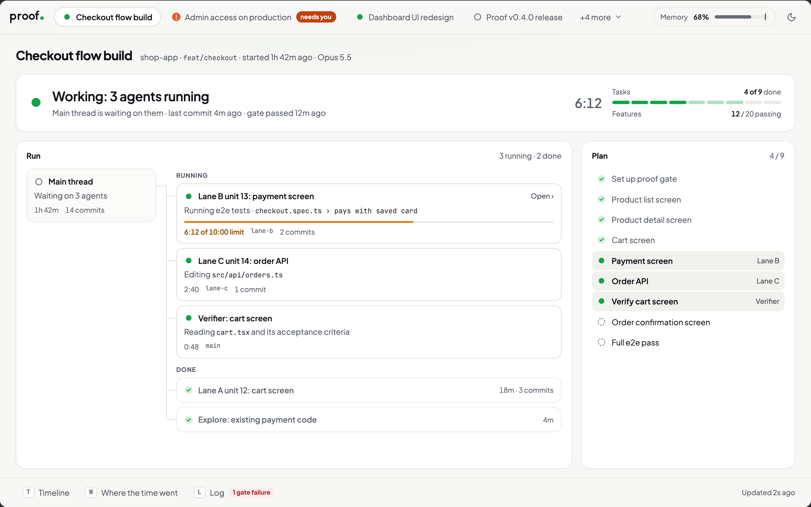
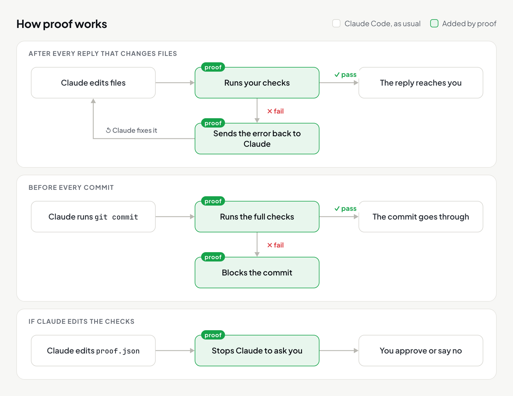

<div align="center">

<picture><source media="(prefers-color-scheme: dark)" srcset="assets/logo-dark.svg"></picture>

### Quit babysitting Claude. Make it check its own work.

[](https://github.com/IfeOlulesi/proof/actions/workflows/test.yml) [](LICENSE)

[Install](#install) · [Turn it on](#turn-it-on-in-a-project) · [Phases](#working-in-phases) · [Config](#configuration)

</div>

<br>

proof is a Claude Code plugin. It runs your project's checks (types, lint, tests) every time Claude finishes a reply and before every `git commit`. If a check fails, Claude gets the error and keeps working. You stop being the person who catches the mistakes.

It also adds checks for the parts tests usually miss: whether a spec is complete, whether a mockup covers every state, and whether a screen matches its mockup.

<picture>
  <source media="(prefers-color-scheme: dark)" srcset="assets/dashboard-dark.png">
  
</picture>

<p align="center"><sub>The live dashboard (<code>/proof:watch</code>), showing a session with three agents at work. Sample data.</sub></p>

## What it catches

| ❌ Without proof | ✅ With proof |
|---|---|
| **Claude says "done"**<br><sub>…and the tests fail when you run them.</sub> | Checks run after every reply that changes files. Claude sees the failure and fixes it before handing back. |
| **A failing check gets switched off**<br><sub>…so the work "passes".</sub> | Editing `proof.json`, `settings.json` or the fidelity kit makes Claude stop and ask you first. |
| **The screen is *almost* the design**<br><sub>Wrong copy, a few pixels off, the wrong grey.</sub> | Every tagged element is checked against the mockup: exact copy, position and size within 2px, font, colour. |
| **The empty state never got built**<br><sub>The spec didn't mention it.</sub> | Every state needs its own mockup frame, and every requirement says how it'll be verified. |
| **A test run hangs**<br><sub>Claude waits forever.</sub> | Test runs and builds have time limits. A breach is reported as a hang. |
| **Your laptop freezes**<br><sub>Three agents and a simulator at once.</sub> | Heavy runs wait for memory. If the machine goes over the ceiling, the newest run is stopped. |
| **You come back after an hour**<br><sub>No idea what happened.</sub> | The dashboard shows every session: what's running, for how long, the plan and the check results. |

## Install

Open Claude Code and paste this:

```
Install the proof plugin (github.com/IfeOlulesi/proof).

1. It needs git and Node.js 20 or later on my PATH. Check both first. If either is
   missing or too old, tell me and offer to install it.
2. Run `claude plugin marketplace add IfeOlulesi/proof`, then
   `claude plugin install proof@proof`. Check `claude plugin list` shows
   proof@proof as enabled.
3. If we're in a git repo, turn proof on here: write .claude/proof.json
   (format: github.com/IfeOlulesi/proof#turn-it-on-in-a-project) with checks for
   the type check, lint and tests this project already uses. Run each one once
   and show me which pass and which fail.
4. Finally, tell me to run /reload-plugins.
```

Claude checks for git and Node.js, asks before installing anything, installs proof, and sets it up in the project you're in.

> [!TIP]
> When it's done, run `/reload-plugins` (or restart Claude Code) to load proof.

<details>
<summary>Install by hand instead</summary>

You need git and Node.js 20+ on your `PATH`. Then, in a terminal:

```bash
claude plugin marketplace add IfeOlulesi/proof && claude plugin install proof@proof
```

Restart Claude Code. `claude plugin list` should show `proof@proof` as enabled.

</details>

> [!NOTE]
> Tested on macOS and Linux.

## Turn it on in a project

The gate only runs in a repo that has a `.claude/proof.json` listing its checks. The install prompt writes it for the project you installed from. For any other project, open Claude Code there and paste:

```
Set up proof in this repo: write .claude/proof.json with checks for the type
check, lint and tests this project already uses. Then run every check once and
show me which pass and which fail.
```

Or write the file yourself:

```json
{
  "checks": [
    { "name": "types", "run": "npx tsc --noEmit" },
    { "name": "test",  "run": "npx jest --ci" }
  ]
}
```

From then on, this is what happens:

<picture>
  <source media="(prefers-color-scheme: dark)" srcset="assets/how-it-works-dark.png">
  
</picture>

Claude can't loosen a check to get past it: if it edits `.claude/proof.json`, `.claude/settings.json` or the fidelity kit, it has to stop and ask you first.

Run the checks yourself any time with `node <plugin>/scripts/gate.mjs --run` (`<plugin>` is the plugin's folder; Claude knows its path).

## Working in phases

Claude picks the right phase on its own, or you can call one:

| Command | For | Checks that |
|---|---|---|
| [`/proof:discover`](plugins/proof/skills/discover/SKILL.md) | Idea → spec | Every requirement says how it's verified |
| [`/proof:design`](plugins/proof/skills/design/SKILL.md) | Spec → HTML mockup | Every screen, state and test ID exists |
| [`/proof:build`](plugins/proof/skills/build/SKILL.md) | Any code change | Tests come first, the app is run, screens match the mockup |
| [`/proof:quick`](plugins/proof/skills/quick/SKILL.md) | Fixes up to 3 files | The narrowest check passes, then the commit gate |
| [`/proof:watch`](plugins/proof/skills/watch/SKILL.md) | Long or parallel work | Opens the live dashboard |

Before each unit of work is committed, a separate `proof:verifier` agent reviews it against what was asked, in a fresh context.

## Running several sessions at once

Parallel sessions with test runners, dev servers and simulators can run a laptop out of memory. proof keeps the machine under a ceiling (85% by default):

- **Heavy runs and new agents wait** until there's room.
- **If the machine goes over anyway**, the newest run Claude started is stopped.
- **Your apps are never closed.** proof tells you which ones are using the most.

On macOS it also keeps the machine from idle-sleeping while Claude is working.

<br>

---

# Reference

## Configuration

<details>
<summary>All <code>.claude/proof.json</code> options</summary>

```json
{
  "checks": [
    { "name": "test", "run": "npx jest --ci",
      "fast": "npx jest --ci --passWithNoTests --findRelatedTests {files}",
      "files": ["src/**/*.{ts,tsx}"], "fullWhen": ["jest.config.js", "package.json"],
      "when": ["src/", "jest.config.js", "package.json"], "timeout": 600 }
  ],
  "maxRounds": 5
}
```

Per check:

- `run`: the full command. Runs before every commit, and after each reply when there's no `fast`.
- `fast`: a quicker command for after each reply. `{files}` becomes the changed files that match `files`.
- `fullWhen`: changed files that force the full command anyway.
- `when`: only run the check when files under these paths changed.
- `cache: false`: for checks that depend on more than the code, like a running app. Otherwise a pass is cached against the exact code for 12 hours.
- `timeout`: seconds.

Top level:

- `maxRounds` (5): how many times Claude is sent back after a reply before you're told what still fails.
- `concurrency` (4): how many checks run at once.
- `maxMemoryMB` / `maxProcessMemoryMB`: memory limits for a run and for one process. Default: half and a quarter of RAM.
- `testRunTimeout` (900), `buildTimeout` (1800), `waitTimeout` (300): seconds before a run Claude started is treated as hung.
- `quick`: `{ "maxFiles": 3, "maxLines": 100 }`, the size limit for `/proof:quick`.

To add the spec and design checks to the gate, see the [discover](plugins/proof/skills/discover/SKILL.md#check) and [design](plugins/proof/skills/design/SKILL.md#check) skills.

</details>

<details>
<summary>Machine settings: <code>~/.config/proof/machine.json</code></summary>

```json
{
  "memoryWarnPercent": 75,
  "memoryCeilingPercent": 85,
  "keepAwake": true,
  "dashboardPort": 47331,
  "autoOpenDashboard": true,
  "autoOpenAfterMinutes": 45,
  "admitWaitSeconds": 180
}
```

</details>

## Update

```bash
claude plugin marketplace update proof
claude plugin update proof@proof
```

If a repo has a `fidelity/` folder, also run `node <plugin>/skills/build/fidelity-kit/install.mjs --upgrade` once on its main branch.

## Privacy

proof makes no network calls. The dashboard listens on 127.0.0.1 only. It reads Claude Code's own logs in `~/.claude` to draw the dashboard, and only ever stops processes Claude started.

## Limits

- The gate needs a git repo.
- Cloud sessions (claude.ai/code) don't load plugins.
- Checks that depend on ignored files (like `.env`) or a running service should set `cache: false`.
- The mockup comparison measures anything that renders in a browser, including Expo web. Flutter and native apps are checked with screenshots instead.

## Develop

```bash
git clone https://github.com/IfeOlulesi/proof.git
claude plugin marketplace add ./proof
claude plugin install proof@proof
bash tests/run.sh
```

Edits take effect at the next session or after `/reload-plugins`. The tests run in throwaway repos and a throwaway home folder, take about three minutes, and run in CI on Linux and macOS. If you change the dashboard, update [`docs/dashboard-spec.md`](plugins/proof/docs/dashboard-spec.md).

## License

[MIT](LICENSE)
