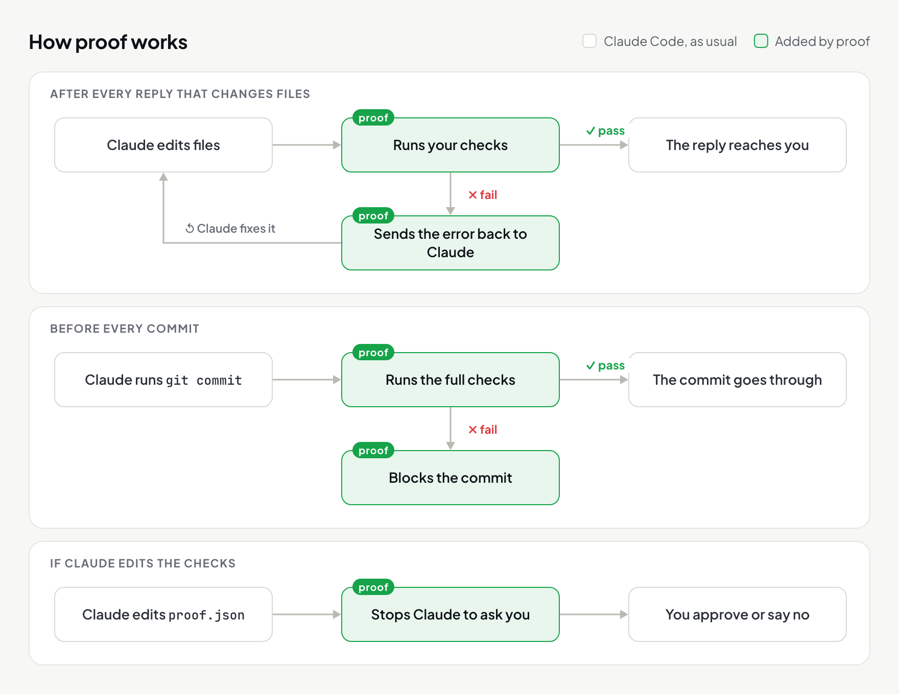
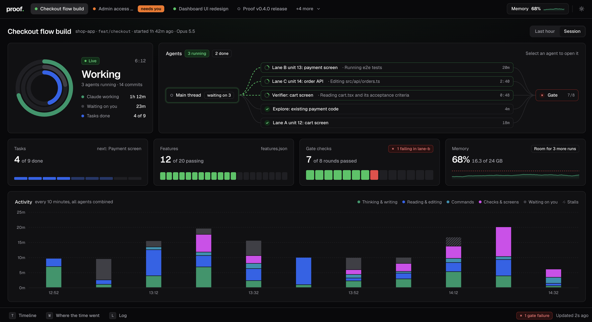

<div align="center">

<picture><source media="(prefers-color-scheme: dark)" srcset="assets/logo-dark.svg"></picture>

### Your agent says "done". proof makes sure it is.

[](https://github.com/IfeOlulesi/proof/actions/workflows/test.yml) [](LICENSE)

[Website](https://ifeolulesi.github.io/proof/) · [Install](#install) · [How it works](#how-it-works) · [Phases](#from-idea-to-working-app) · [Config](#configuration)

</div>

<br>

A free plugin for Claude Code. Coding agents move fast. proof double-checks their work before it reaches you: pages load, buttons do what they should, screens match the design. If something's off, your agent fixes it first.

## The problem

Fast work still needs checking. Usually by you. A button that doesn't respond. A page that never loads. A screen that's almost, but not quite, the design. Small things slip through, and you're the one who finds them.

## How it works

Your agent checks its own work, before you ever see it. Each time your agent finishes, proof checks the app still works. If something's off, the agent sees exactly what and fixes it before handing back.

- **Fails go back to your agent.** Your agent gets the error and keeps working. You see the reply once the checks pass.
- **Commits are gated.** Before every git commit the full checks run. A failure blocks the commit.
- **Checks can't be loosened.** If your agent edits `proof.json`, proof stops it and asks you first.

<picture>
  <source media="(prefers-color-scheme: dark)" srcset="assets/how-it-works-dark.png">
  
</picture>

## What it catches

Seven ways "done" can slip. proof catches all seven.

| ❌ Without proof | ✅ With proof |
|---|---|
| **Your agent says "done"**<br><sub>…and the tests fail when you run them.</sub> | Checks run after every reply that changes files. Your agent sees the failure and fixes it before handing back. |
| **A failing check gets switched off**<br><sub>…so the work "passes".</sub> | Editing `proof.json`, `settings.json` or the fidelity kit makes your agent stop and ask you first. |
| **The screen is *almost* the design**<br><sub>Wrong copy, a few pixels off, the wrong grey.</sub> | Every tagged element is checked against the mockup: exact copy, position and size within 2px, font, colour. |
| **The empty state never got built**<br><sub>The spec didn't mention it.</sub> | Every state needs its own mockup frame, and every requirement says how it'll be verified. |
| **A test run hangs**<br><sub>Your agent waits forever.</sub> | Test runs and builds have time limits. A breach is reported as a hang. |
| **Your laptop freezes**<br><sub>Three agents and a simulator at once.</sub> | Heavy runs wait for memory. If the machine goes over the ceiling, the newest run is stopped. |
| **You come back after an hour**<br><sub>No idea what happened.</sub> | The dashboard shows every session: what's running, for how long, the plan and the check results. |

## Install

Open Claude Code and paste this:

```
Install the proof plugin (github.com/IfeOlulesi/proof).

1. It needs git and Node.js 20 or later on my PATH. Check both first. If either is
   missing or too old, tell me and offer to install it.
2. Run `claude plugin marketplace add IfeOlulesi/proof`, then
   `claude plugin install proof@proof`. Check `claude plugin list` shows
   proof@proof as enabled.
3. Turn on auto-update for it: in ~/.claude/settings.json, add
   "proof": { "source": { "source": "github", "repo": "IfeOlulesi/proof" },
   "autoUpdate": true } under "extraKnownMarketplaces". If you can't edit that
   file, tell me to do it in /plugin → Marketplaces → proof → Enable auto-update.
4. If we're in a git repo, turn proof on here: write .claude/proof.json
   (format: github.com/IfeOlulesi/proof#turn-it-on-in-a-project) with checks for
   the type check, lint and tests this project already uses. Run each one once
   and show me which pass and which fail.
5. Finally, tell me to run /reload-plugins.
```

Claude checks for git and Node.js, asks before installing anything, installs proof with auto-update on, and sets it up in the project you're in.

> [!TIP]
> When it's done, run `/reload-plugins` (or restart Claude Code) to load proof.

<details>
<summary>Install by hand instead</summary>

You need git and Node.js 20+ on your `PATH`. Then, in a terminal:

```bash
claude plugin marketplace add IfeOlulesi/proof && claude plugin install proof@proof
```

Restart Claude Code. `claude plugin list` should show `proof@proof` as enabled. Then turn on auto-update: `/plugin` → Marketplaces → proof → Enable auto-update.

</details>

> [!NOTE]
> Tested on macOS and Linux.

## Turn it on in a project

The gate only runs in a repo that has a `.claude/proof.json` listing its checks. The install prompt writes it for the project you installed from. For any other project, open Claude Code there and paste:

```
Set up proof in this repo: write .claude/proof.json with checks for the type
check, lint and tests this project already uses. Then run every check once and
show me which pass and which fail.
```

Or write the file yourself:

```json
{
  "checks": [
    { "name": "types", "run": "npx tsc --noEmit" },
    { "name": "test",  "run": "npx jest --ci" }
  ]
}
```

Run the checks yourself any time with `node <plugin>/scripts/gate.mjs --run` (`<plugin>` is the plugin's folder; Claude knows its path).

## From idea to working app

Checked at every step. Your agent plans it, designs it, then builds it. Each step has to pass before the next one starts, and a second agent double-checks the work before it's saved. Your agent picks the right phase on its own, or you can call one:

| Command | For | Checks that |
|---|---|---|
| [`/proof:discover`](plugins/proof/skills/discover/SKILL.md) | Idea → spec | Every requirement says how it's verified |
| [`/proof:design`](plugins/proof/skills/design/SKILL.md) | Spec → HTML mockup | Every screen, state and test ID exists |
| [`/proof:build`](plugins/proof/skills/build/SKILL.md) | Any code change | Tests come first, the app is run, screens match the mockup |
| [`/proof:quick`](plugins/proof/skills/quick/SKILL.md) | Fixes up to 3 files | The narrowest check passes, then the commit gate |
| [`/proof:watch`](plugins/proof/skills/watch/SKILL.md) | Long or parallel work | Opens the live dashboard |

The second agent is `proof:verifier`: before each unit of work is committed, it reviews it against what was asked, in a fresh context.

## The dashboard

Walk away for an hour. See what happened at a glance. `/proof:watch` shows every session live: what your agents are working on, how far they've got, and whether everything still works.



<p align="center"><sub>A session's home on the dashboard, in dark mode. Sample data.</sub></p>

- **Needs you, in coral.** A session that stopped on a question stands out from the ones still working.
- **Every agent in one run view.** Lanes, verifiers and explorers, with timers and commits.
- **Local only.** Listens on 127.0.0.1.

## Running several sessions at once

Run three agents at once. Your laptop keeps up. proof keeps an eye on memory and makes the heavy jobs take turns, so your computer never freezes. It keeps the machine under a ceiling (90% by default):

- **Heavy runs and new agents wait** until there's room.
- **If the machine goes over anyway**, the newest run your agent started is stopped.
- **Your apps are never closed.** proof tells you which ones are using the most.

On macOS it also keeps the machine from idle-sleeping while your agent is working.

## Roadmap

- **Other agent harnesses.** Codex CLI first, then Gemini CLI, Antigravity and OpenCode. The checks and limits are plain Node; what needs adapting is the hook wiring and the dashboard's log reader.
- **Checks in CI.** A GitHub Action that runs the same `.claude/proof.json`, for cloud sessions and pull requests that didn't come from your agent.
- **Setup that writes `proof.json` for you.** Suggests checks from `package.json`, `pyproject.toml` or `Cargo.toml`.
- **Flaky tests named, not hidden.** A failure that passes on a re-run is reported as flaky.
- **Notifications when your agent needs you.** A desktop or phone alert when a session stops on a question or runs out of rounds.
- **Accessibility checks** in the design gate: contrast and basic rules on every screen.
- **Closer comparison for Flutter and native apps**, beyond screenshots.
- **Linux and Windows parity** for keep-awake and memory pressure.
- **History on the dashboard.** Check results over time and how long each unit took.

<br>

---

# Reference

## Configuration

<details>
<summary>All <code>.claude/proof.json</code> options</summary>

```json
{
  "checks": [
    { "name": "test", "run": "npx jest --ci",
      "fast": "npx jest --ci --passWithNoTests --findRelatedTests {files}",
      "files": ["src/**/*.{ts,tsx}"], "fullWhen": ["jest.config.js", "package.json"],
      "when": ["src/", "jest.config.js", "package.json"], "timeout": 600 }
  ],
  "maxRounds": 5
}
```

Per check:

- `run`: the full command. Runs before every commit, and after each reply when there's no `fast`.
- `fast`: a quicker command for after each reply. `{files}` becomes the changed files that match `files`.
- `fullWhen`: changed files that force the full command anyway.
- `when`: only run the check when files under these paths changed.
- `cache: false`: for checks that depend on more than the code, like a running app. Otherwise a pass is cached against the exact code for 12 hours.
- `timeout`: seconds.

Top level:

- `maxRounds` (5): how many times Claude is sent back after a reply before you're told what still fails.
- `concurrency` (4): how many checks run at once.
- `maxMemoryMB` / `maxProcessMemoryMB`: memory limits for a run and for one process. Default: half and a quarter of RAM.
- `testRunTimeout` (900), `buildTimeout` (1800), `waitTimeout` (300): seconds before a run Claude started is treated as hung.
- `quick`: `{ "maxFiles": 3, "maxLines": 100 }`, the size limit for `/proof:quick`.

To add the spec and design checks to the gate, see the [discover](plugins/proof/skills/discover/SKILL.md#check) and [design](plugins/proof/skills/design/SKILL.md#check) skills.

</details>

<details>
<summary>Machine settings: <code>~/.config/proof/machine.json</code></summary>

```json
{
  "memoryWarnPercent": 75,
  "memoryCeilingPercent": 85,
  "keepAwake": true,
  "dashboardPort": 47331,
  "autoOpenDashboard": true,
  "autoOpenAfterMinutes": 45,
  "admitWaitSeconds": 180,
  "updateCheck": true
}
```

</details>

## Update

Claude Code updates plugins on its own only for marketplaces with auto-update on, and it's off for third-party marketplaces like this one until you turn it on: `/plugin` → Marketplaces → proof → Enable auto-update. The install prompt above does this for you.

Without it, proof tells Claude when a newer version is out, at the start of a session, and Claude offers to update. To update by hand:

```bash
claude plugin marketplace update proof
claude plugin update proof@proof
```

If a repo has a `fidelity/` folder, also run `node <plugin>/skills/build/fidelity-kit/install.mjs --upgrade` once on its main branch.

## Privacy

proof makes one network call: at most once a day, in the background, it reads the released version number from GitHub (`raw.githubusercontent.com`) to tell you about updates. Nothing is sent. Turn it off with `"updateCheck": false` in `~/.config/proof/machine.json`. The dashboard listens on 127.0.0.1 only. It reads Claude Code's own logs in `~/.claude` to draw the dashboard, and only ever stops processes Claude started.

## Limits

- The gate needs a git repo.
- Cloud sessions (claude.ai/code) don't load plugins.
- Checks that depend on ignored files (like `.env`) or a running service should set `cache: false`.
- The mockup comparison measures anything that renders in a browser, including Expo web. Flutter and native apps are checked with screenshots instead.

## Develop

```bash
git clone https://github.com/IfeOlulesi/proof.git
claude plugin marketplace add ./proof
claude plugin install proof@proof
bash tests/run.sh
```

Edits take effect at the next session or after `/reload-plugins`. The tests run in throwaway repos and a throwaway home folder, take about three minutes, and run in CI on Linux and macOS. If you change the dashboard, update [`docs/dashboard-spec.md`](plugins/proof/docs/dashboard-spec.md).

## License

[MIT](LICENSE)
